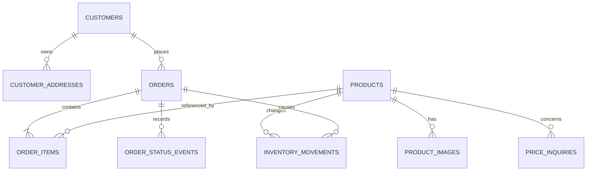

# المرحلة صفر — تقييم Eltwenz Store

**التاريخ:** 24 أكتوبر 2026

**الحالة:** تقرير Phase 0 محفوظ كمرجع. بدأ تنفيذ Phase 1 بعد موافقة المستخدم؛ حالة العمل الحالية مضافة في آخر المستند.

## الموجود في المستودع

- واجهة متجر عربية RTL وصفحات منتج وفئات وسلة وطلب واستفسار عن السعر وحساب عميل ولوحة إدارة.
- API داخل `outputs/server.js` مبني على Node.js 20 من غير dependencies. فيه تخزين محلي في ملفات JSON، أو تخزين بعيد عبر Supabase REST في جدول `store_records` واحد بأعمدة `collection` و`id` و`payload JSONB`.
- إعدادات النشر تشمل Render وNetlify. تطبيق Render الحالي مضبوط على الخطة المجانية، وNetlify يشغّل نسخة static مع Function تعيد استخدام الـ API.
- فيه ملفا إعداد Render في الجذر وداخل `outputs/` بإعدادات مختلفة، وملف التشغيل العربي يشرح النسخة المحلية فقط؛ لازم نثبت مصدر إعداد واحد ونحدّث التوثيق قبل أي نشر.
- ملفات الطلبات والعملاء والاستفسارات ورمز الإدارة runtime محلية ومتجاهلة من Git؛ لم أفتح محتواها. وقت مراجعة Phase 0 ماكانش فيه test suite؛ Phase 1 أضافت الاختبارات في `outputs/tests/`.
- الأسعار والشحن وطريقة الدفع النهائية يتأكدوا يدويًا مع العميل. لا يوجد في المستودع إعداد موثّق أو تحقق فعلي لتكامل دفع أو شركة شحن أو إشعارات.

## المعمارية المقترحة

نطوّر التطبيق الحالي تدريجيًا كـ **monolith**: واجهة المتجر وAPI على Node.js، مع Supabase Postgres للتخزين الدائم. Render هو الاختيار المبدئي المقترح لاستضافة التطبيق لأنه يشغّل نفس خادم Node الحالي مباشرة؛ نوقف تعدد خيارات النشر ونحسم Render كهدف واحد قبل تجهيز cutover. ده اقتراح للتخطيط فقط، مش إعداد خدمة أو نشر.

نقلّل المخاطر بتغيير طبقة التخزين أولًا مع الحفاظ على صفحات وسلوك المتجر الحالي. يظل مفتاح Supabase من نوع service role داخل السيرفر فقط، مع RLS مقفول أمام `anon` و`authenticated`. العمليات التي تعدّل الطلب والمخزون تتم كمعاملة واحدة في PostgreSQL (عبر SQL functions/RPC أو معاملة قاعدة بيانات مناسبة)، بدل حفظ ملفات/سجلات متعددة على خطوات منفصلة.

المراجعة كشفت نقطتين أمان وتشغيل ضمن النطاق: رمز الإدارة نفسه بيُستخدم حاليًا لتوقيع جلسة العميل، وواجهة الإدارة بتخزنه في `sessionStorage`؛ كمان حدود المحاولات محفوظة في ذاكرة عملية Node واحدة. Phase 1 يفصل سر الجلسة ويقوي جلسة الإدارة ويضيف حماية تعمل مع أكثر من نسخة سيرفر. يفضل عدم توسيع استخدام bearer token الحالي.

## تصميم قاعدة البيانات المقترح

| الجدول | البيانات الأساسية والغرض |
| --- | --- |
| `products` | الاسم، التصنيف، الوصف، السعر، الخصم، المخزون، حالة الظهور، ووقت التعديل. السعر قد يظل غير محدد حسب السلوك الحالي. |
| `product_images` | صور المنتج وترتيب عرضها، مع ربطها بمعرّف المنتج. |
| `customers` | الاسم، رقم الهاتف الموحّد والفريد، hash كلمة المرور، وتواريخ الإنشاء والتعديل. |
| `customer_addresses` | عناوين العميل. الطلب يحتفظ بنسخة من عنوان التسليم وقت الطلب حتى لا يتغير تاريخ الطلب عند تحديث العنوان. |
| `shipping_rates` | المحافظة، تكلفة التوصيل بالجنيه، التفعيل، وآخر تعديل. |
| `orders` | رقم الطلب العام، العميل إن كان مسجلًا، نسخة الاسم والهاتف والعنوان، الحالة، المجموع الفرعي والشحن والإجمالي بالجنيه، ومواعيد الإنشاء والتعديل. يظل اختيار الدفع/تأكيد الإجمالي يدويًا. |
| `order_items` | المنتج إن كان موجودًا، ونسخ الاسم والسعر الأصلي والخصم والسعر النهائي والكمية وقت الطلب. |
| `order_status_events` | سجل تغييرات حالة الطلب ووقتها ومن نفّذها؛ لا يخزّن أسرار الدخول. |
| `inventory_movements` | حركات إضافة/خصم/إرجاع المخزون، مربوطة بالطلب عند الحاجة، لمنع تكرار الخصم والإرجاع. |
| `price_inquiries` | المنتج، اسم ورقم العميل، الرسالة، الحالة، وتواريخ المتابعة. |

قيود مطلوبة: السعر والخصم والتكلفة بقيم `numeric` مناسبة بدل float؛ الكمية أعداد صحيحة موجبة؛ الخصم من 0 إلى 100؛ حالات الطلب والاستفسار محددة؛ رقم الهاتف الموحّد فريد؛ ومفاتيح أجنبية مع حذف/أرشفة آمنين. يظل سجل اسم/سعر المنتج داخل `order_items` حتى عند إخفاء المنتج أو تحديثه.

**قرار مخزون مطلوب قبل كود Phase 1:** النسخة الحالية تخصم المخزون عند تحويل الطلب إلى «مكتمل»، بينما التحقق عند إنشاء الطلب لا يحجز الكمية؛ لذلك ممكن طلبان مفتوحان يتجاوزوا المخزون المتاح. الاقتراح هو تنفيذ الخصم/الإرجاع ذريًا مع تغيير الحالة، مع تثبيت السلوك الحالي في البداية. لو سياسة المتجر تحجز عند التأكيد أو عند إنشاء الطلب، لازم تتحدد قبل التنفيذ.

## ترحيل البيانات

1. تحديد المصدر الفعلي للبيانات: Supabase الحي أو ملفات التشغيل المحلية؛ عدم افتراض أن بيانات المستودع هي بيانات المتجر الفعلية.
2. أخذ نسخة احتياطية قابلة للاسترجاع، مع حصر أعداد السجلات فقط في التقارير.
3. تحويل `store_records` ومصادر JSON إلى جداول العلاقات، وفحص التكرار والحقول غير الصالحة دون طباعة أسماء العملاء أو الهواتف أو العناوين.
4. تشغيل dry run ومقارنة أعداد السجلات والـ totals، ثم تجربة rollback والاستعادة على بيئة اختبار.
5. لا يحصل cutover للإنتاج إلا بعد موافقة منفصلة وخطة نافذة تغيير واسترجاع.

## خطة التنفيذ بعد موافقتك

| الـ milestone | النتيجة القابلة للمراجعة | التحقق المطلوب |
| --- | --- | --- |
| 1. أساس الاختبار والمخطط | اختبارات أساسية للسلوك الحالي، migrations قابلة للتكرار، وأداة dry run للهجرة. | syntax/build، تطبيق schema على قاعدة محلية أو مؤقتة، وفحوص صحة بيانات من غير PII. |
| 2. طبقة البيانات والمعاملات | جداول العلاقات وقراءة/كتابة من خلال طبقة بيانات واضحة؛ إنشاء الطلب وتحديث الحالة وحركات المخزون ذرية. | اختبارات API وقاعدة بيانات للطلب، الأسعار، المخزون، الإلغاء، والتكرار/التزامن. |
| 3. الحسابات والأمان | فصل سر توقيع الجلسة عن رمز الإدارة، تقوية جلسات الإدارة والعملاء وحدود المحاولات، وتثبيت قيود RLS والصلاحيات. | اختبارات دخول ورفض غير المصرح به وCSRF والتحقق من عدم تسريب الأسرار أو PII في logs. |
| 4. توافق الواجهة والإدارة | المتجر واللوحة يكمّلوا استخدام API الجديد مع الحفاظ على العربية وRTL وسير الطلب اليدوي؛ توحيد توثيق التشغيل وملف النشر المعتمد. | build ثابت واختبارات smoke للكتالوج والسلة والطلب والحساب والإدارة على بيئة محلية. |
| 5. جاهزية الإطلاق | توثيق متغيرات البيئة والنسخ الاحتياطي والاستعادة، وتشغيل تجريبي على staging إن كان متاحًا. | تقرير نتائج واختبار استعادة ومراجعة يدوية؛ لا نشر إنتاجي أو تفعيل خدمة مدفوعة دون موافقة صريحة. |

مافيش حاليًا framework اختبارات؛ أول milestone هيضيف اختبارات محددة قبل تغيير مسار الطلب أو قاعدة البيانات. كل milestone يتراجع ويتفحص لوحده، ومش هيتولد التطبيق كله دفعة واحدة.

## تقدير التكلفة الشهري

الأسعار بالدولار الأمريكي، قبل الضريبة أو تحويل العملة أو اسم النطاق أو أي تجاوزات استخدام:

| السيناريو | التقدير | ملاحظات |
| --- | ---: | --- |
| تشغيل محلي | $0 | يحتاج Node.js فقط. |
| نموذج مجاني للتجربة | $0 | Render Free مع Supabase Free. Render المجاني ينام بعد 15 دقيقة بدون زيارات وقد يستغرق إفاقته نحو دقيقة؛ Supabase Free يوقف المشروع بعد أسبوع من عدم النشاط. مناسب للتجربة وليس اعتماد متجر إنتاجي. |
| تشغيل إنتاجي خفيف مقترح | نحو **$32/شهر** | Render web service على `0.5c-512mb` بسعر $7/شهر + Supabase Pro يبدأ من $25/شهر. لا يشمل نطاقًا أو ضرائب أو زيادة استخدام. |
| Netlify بدل Render | $25–34/شهر تقريبًا مع Supabase Pro | Netlify Free $0 أو Personal $9/شهر، وSupabase Pro $25/شهر؛ رصيد Netlify المجاني محدود بـ300 credit وقد يوقف المشاريع عند استنفاده. هذا يتطلب اعتماد مسار Functions بدل خادم Render. |

Render يصف خطته المجانية بأنها للتجربة لا للإنتاج، وملفاتها المحلية مؤقتة؛ لذلك تكون قاعدة البيانات الخارجية الدائمة ضرورية. Supabase Pro يشمل 8 GB database و250 GB egress ونسخًا يومية لـ7 أيام حسب صفحة التسعير. التقدير لا يشمل رسوم بوابة دفع أو الشحن أو SMS/WhatsApp؛ هذه الخدمات غير محددة وغير مفعّلة في المشروع.

المصادر الرسمية التي تمت مراجعتها في 24 أكتوبر 2026: [Render pricing](https://render.com/pricing)، [Render Free instance limits](https://render.com/docs/free)، [Supabase pricing](https://supabase.com/pricing)، [Netlify plans](https://www.netlify.com/pricing/).

## موافقة Phase 1

المستخدم وافق على بدء Phase 1. الافتراض المبدئي يظل خصم المخزون عند إكمال الطلب؛ لا يوجد اعتماد لنشر أو خدمة مدفوعة، وأي إجراء إنتاجي يحتاج موافقة صريحة منفصلة.

## تنفيذ Phase 1 — 24 أكتوبر 2026

أُضيفت migration علائقية إضافية مع RLS وصلاحيات محصورة في `service_role`، وعمليات RPC للطلب وتحديث الحالة/المخزون، وطبقة PostgREST اختيارية تحت `STORE_SCHEMA=relational`. الوضع الافتراضي ما زال `legacy`، ولا تتحول ملفات النشر تلقائيًا. تم الحفاظ على بيانات المنتجات الإضافية مثل `basePrice` و`sourceListedPrice` و`sourceListedDiscount`.

أُضيفت أداة `outputs/scripts/validate-legacy-export.js` لفحص export مطعّم أو منقح، وتعرض counts وأكواد مشاكل فقط. الأداة لا تستورد البيانات. أُضيفت اختبارات Node مدمجة، وتقوية للجلسات عبر cookies موقعة وسر جلسة منفصل، وCSRF، وحدود محاولات مشتركة في وضع relational. واجهة الإدارة لم تعد تحتفظ برمز الإدارة في `sessionStorage`.

المخطط لم يُطبّق على PostgreSQL/Supabase؛ لا تتوفر في بيئة العمل أدوات `psql` أو Docker أو بيانات اعتماد staging، ولم تُقرأ ملفات التشغيل المحلية الحساسة. يلزم قبل cutover تجهيز export من مصدر معتمد، ومراجعة dry-run، وتجربة استيراد/استرجاع على staging، ثم موافقة منفصلة. لا يوجد تكامل دفع أو شحن أو إشعارات تم تفعيله أو التحقق منه.

نتائج التحقق المحلي: `node --test` شغّل 15 اختبارًا مدمجًا بعد آخر تحديث؛ فحوص `node --check` للسيرفر والـ adapter والسكريبت والاختبارات وNetlify Function نجحت؛ بناء الواجهة نجح داخل مجلد مؤقت معزول؛ و`git diff --check` نجح. التحذيرات الوحيدة من Git كانت عن تحويل LF إلى CRLF على Windows. `npm test` لم يُشغّل لعدم توفر npm.

التحقق البنيوي من SQL محدود بمراجعة المصدر واختبار static؛ لم يتوفر `psql` أو Docker أو اتصال staging، لذلك لم تُطبّق migration ولم تُشغّل PostgreSQL integration checks. لم يحصل deploy أو تغيير بيانات أو تفعيل خدمات مدفوعة. يظل `STORE_SCHEMA=legacy` هو الإعداد الافتراضي في الكود وملفات Render.

## قرار تخزين صور الاستضافة — 25 أكتوبر 2026

اختار المستخدم OneDrive بحساب Microsoft شخصي لصور المنتجات على Render Free، بدل الاعتماد على قرص محلي مؤقت. التصميم يستخدم Graph delegated app-folder permission، ويحفظ المنتج معرّف عنصر OneDrive فقط. السيرفر يشفر refresh token بـAES-256-GCM ويخزنه في `store_records` بصلاحيات service role، ويقدّم الصور عبر proxy يتحقق من وجود المعرّف في كتالوج المنتجات ونوع الملف وحجمه. صور الجهاز المحلي تظل محلية أثناء التطوير. لا توجد خدمة مدفوعة جديدة في التصميم؛ الاستخدام يخضع لمساحة OneDrive وحدود حساب Microsoft الموجود.

التنفيذ البرمجي والاختبارات المحاكية اكتملوا محليًا. الاتصال الحقيقي ما زال يحتاج تسجيل تطبيق Microsoft، ضبط `ONEDRIVE_CLIENT_ID` في Render، ثم موافقة حساب OneDrive ورفع/قراءة صورة فعلية. لذلك لم يُعلن التكامل عاملًا بعد، ولا يحتوي الاختبار الآلي على حساب أو ملفات حقيقية. هذا التصميم لم يُفعّل؛ القرار الحالي مذكور أدناه.

## قرار تخزين الصور المحدّث — 25 أكتوبر 2026

استبدل المستخدم اختيار OneDrive بـSupabase Storage المجاني. التكامل الجديد يستخدم bucket عام مخصص باسم product-images؛ الرفع يتم عبر السيرفر بمفتاح service_role فقط، وتُخزن الروابط العامة للصورة في سجل المنتج. يظل حد الملف 5 MiB مع فحص التوقيع الفعلي للملف في السيرفر. صور المنتجات عامة بطبيعتها، لذلك لا يجوز وضع صور خاصة في هذا المخزن. الخطة المجانية تشمل 1 GB لتخزين الملفات و5 GB نقل مخزن مؤقتًا و5 GB نقل غير مخزن مؤقتًا، ومشروع Free قد يتوقف بعد أسبوع من عدم النشاط. يحتاج الإعداد إلى إنشاء bucket من لوحة Supabase، ثم اختبار رفع وقراءة صورة فعلية؛ لا يوجد تحقق فعلي من حساب المستخدم حتى الآن.